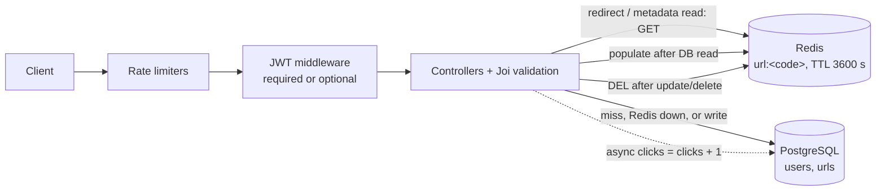

# Shrinkr

**A URL-shortener REST API with JWT auth, owner-scoped link management, link expiry, and a Redis cache in front of PostgreSQL.**

Shrinkr turns long URLs into short codes and redirects visitors to the original address. Anyone can create a
link; registered users can list, update, and delete their own links. Redirects are served from a Redis
cache when possible and fall back to PostgreSQL when Redis misses or is unavailable, so the cache is an
optimisation, never a dependency.

Built with Node.js, Express 5, PostgreSQL, and Redis. A React front end lives in
[`shrinkr-ui/frontend/`](shrinkr-ui/frontend) (not covered by this README or by the audit).

**Live deployment (Render):**
- Front end: <https://shrinkr-urlshortner.onrender.com/login>
- API: <https://shrinkr-zlrw.onrender.com/> (for example `GET /health`)

See [Deployment status](#deployment-status) for exactly what has and has not been checked.

## Contents

- [Feature highlights](#feature-highlights)
- [Tech stack](#tech-stack)
- [Architecture and request flow](#architecture-and-request-flow)
- [API](#api)
- [Local setup](#local-setup)
- [Redis caching and performance benchmark](#redis-caching-and-performance-benchmark)
- [Testing and verification](#testing-and-verification)
- [Security and known limitations](#security-and-known-limitations)
- [Roadmap](#roadmap-future-work-not-implemented)
- [Repository structure](#repository-structure)
- [Deployment status](#deployment-status)
- [License and contributing](#license-and-contributing)

## Feature highlights

- **Shorten and redirect:** 6-character alphanumeric codes (`crypto.randomInt`), retried on a unique-constraint collision (up to 5 attempts). `GET /:shortCode` answers `302`.
- **JWT authentication:** email/password registration and login, bcrypt (cost 10), HS256 tokens, default 7-day expiry.
- **Owner-scoped CRUD:** only the creator can update or delete a link; the write queries also filter on `user_id`. Anonymous links have no owner and cannot be modified through the API.
- **Input validation:** Joi on register, login, create, and update. Only `http://` and `https://` targets are accepted; the scheme match is case-insensitive (`HTTPS://example.com` is valid) and the URL is stored exactly as submitted.
- **Rate limiting:** global, `/urls`, create, and auth limiters (details under [Security and known limitations](#security-and-known-limitations)).
- **Configurable expiry:** `expiration_days` is an integer from 1 to 365 (default 30), enforced on every redirect and metadata read, including for cached rows. It cannot be changed after creation.
- **Click counting:** a counter incremented on each successful redirect (fire-and-forget; see limitations).
- **Redis cache-aside:** `url:<code>` keys, 3600-second TTL, invalidate-on-write, PostgreSQL fallback.
- **Public/private metadata:** `is_public` controls who can read `GET /urls/:shortCode`. **It does not restrict redirects**: anyone who knows a short code can follow it, public or private.

## Tech stack

| Purpose | Technology |
|---|---|
| Runtime / framework | Node.js, Express 5 |
| Database | PostgreSQL via `pg` (no ORM; parameterised SQL) |
| Caching | Redis via `redis` v5 |
| Auth / security | `jsonwebtoken`, `bcrypt`, `express-rate-limit`, `cors` |
| Validation | Joi 18 |
| Testing | Built-in `node:test` runner; real PostgreSQL and Redis (no mocks for the data stores) |
| Local services / benchmark | Docker Compose (`url-shortner/docker-compose.bench.yml`), custom load generator in `url-shortner/scripts/bench/` |

## Architecture and request flow



**Redirect (`GET /:shortCode`):** global rate limiter → Redis `GET` (skipped if Redis is not ready, 250 ms
timeout) → on a miss, `SELECT` from PostgreSQL (`404` if absent) → expiry check (`410` if expired, also
applied to cached rows) → best-effort Redis `SET … EX 3600` → asynchronous click `UPDATE` → `302`.

**Metadata (`GET /urls/:shortCode`):** same lookup path, then the privacy check (`403` unless the link is
public or the caller owns it) runs on every request, cached or not.

**Writes:** `POST /urls` inserts into PostgreSQL (nothing is cached at creation). `PUT` and `DELETE` verify
ownership, write to PostgreSQL, then delete the cache key. Invalidation is best-effort: if Redis is
unreachable the database write still stands and the stale entry lives until its TTL (at most 1 hour).

## API

Base URL (local): `http://localhost:3000`. Requests and responses are JSON. Protected endpoints take
`Authorization: Bearer <jwt>`, where the token is returned by register/login (HS256, signed with `JWT_SECRET`).
"Optional" means a valid token attaches the user; a missing or invalid token continues as anonymous.

| Method | Endpoint | Purpose | Auth |
|---|---|---|---|
| `POST` | `/auth/register` | Create an account; returns a token | None |
| `POST` | `/auth/login` | Log in; returns a token | None |
| `GET` | `/auth/me` | Return the decoded token claims | Required |
| `POST` | `/urls` | Create a short URL | Optional (sets the owner if present) |
| `GET` | `/urls` | List the caller's URLs (unpaginated) | Required |
| `GET` | `/urls/:shortCode` | Read link metadata (privacy-checked) | Optional |
| `PUT` | `/urls/:shortCode` | Update `original_url` and/or `is_public` | Required, owner only |
| `DELETE` | `/urls/:shortCode` | Delete a link | Required, owner only |
| `GET` | `/:shortCode` | Redirect (`302`) to the original URL | None |

That is **9 functional endpoints**. Two health checks are registered as well (`GET /health` and
`GET /urls/health`, no auth). When `ENABLE_DEBUG_METRICS=true` outside production, `GET /__debug/db-stats` and
`POST /__debug/db-stats/reset` are also mounted (benchmark tooling only).

### Request fields

| Endpoint | Body |
|---|---|
| `POST /auth/register`, `POST /auth/login` | `email` (valid email), `password` (string, min 8 characters) |
| `POST /urls` | `original_url` (required, `http`/`https`), `expiration_days` (integer 1–365, default 30), `is_public` (boolean, default `false`) |
| `PUT /urls/:shortCode` | `original_url` (`http`/`https`) and/or `is_public` (boolean); omitted fields keep their value |

### Examples

```bash
# Register (login is the same call to /auth/login). Returns { message, user: { id, email }, token }.
curl -X POST http://localhost:3000/auth/register \
  -H 'Content-Type: application/json' \
  -d '{"email":"you@example.com","password":"change-me-please"}'

export TOKEN='<paste-token-from-response>'

# Create a short URL (omit the Authorization header to create an anonymous one).
# Returns 201 { message, data: { id, short_code, original_url, clicks, created_at, expires_at, user_id, is_public } }
curl -X POST http://localhost:3000/urls \
  -H 'Content-Type: application/json' -H "Authorization: Bearer $TOKEN" \
  -d '{"original_url":"https://example.com/some/long/path","expiration_days":7,"is_public":true}'

# List your URLs. Returns { message, count, data: [...] }
curl http://localhost:3000/urls -H "Authorization: Bearer $TOKEN"

# Read metadata for one link (public links need no token; private ones need the owner's token)
curl http://localhost:3000/urls/<shortCode> -H "Authorization: Bearer $TOKEN"

# Follow a redirect: 302 with a Location header
curl -i http://localhost:3000/<shortCode>
```

### Status codes (from the code and tests)

| Code | When |
|---|---|
| `201` | URL or account created |
| `400` | Validation failure or malformed JSON body |
| `401` | Missing, invalid, or expired token; wrong login credentials |
| `403` | Not the owner (update/delete), or private link read by a non-owner |
| `404` | Unknown short code or route |
| `409` | Email already registered |
| `410` | Link expired |
| `413` | Request body too large (Express's default 100 kB JSON limit, handled in `index.js`; not covered by a test) |
| `429` | Rate limit exceeded |
| `500` | Internal error (generic message) |

Errors are returned as `{ "error": "<message>" }`.

## Local setup

**Prerequisites:** Node.js 21 or newer (`npm test` relies on glob expansion added in Node 21; the audit used
Node 22.21.1), npm, and Docker with Compose for the easiest PostgreSQL + Redis setup. Any PostgreSQL and Redis
you already run also work; the audit used PostgreSQL 16.15 and Redis 7.4.9 in Docker.

```bash
git clone https://github.com/ayesha2104/Shrinkr.git
cd Shrinkr/url-shortner
npm install
cp .env.example .env
```

The clone URL is the `origin` remote configured in this checkout (`git remote -v`); it was not checked
against GitHub.

### Environment variables

| Variable | Required | Notes |
|---|---|---|
| `DB_HOST`, `DB_PORT`, `DB_USER`, `DB_PASSWORD`, `DB_NAME` | Yes | PostgreSQL connection. TLS is on (certificate not verified) unless `DB_SSL=false`, which is meant for a local database without TLS. |
| `REDIS_HOST`, `REDIS_PORT` | Yes | Redis connection |
| `REDIS_PASSWORD` | No | Only needed for a managed or password-protected Redis |
| `JWT_SECRET` | Yes | The server exits at startup without it. Use a long random value. |
| `JWT_EXPIRY` | No | Default `7d` |
| `PORT` | No | Default `3000` |
| `REDIS_COMMAND_TIMEOUT_MS` | No | Default `250` |
| `REDIRECT_CACHE_ENABLED` | No | `false` bypasses Redis on the redirect path (used by the benchmark) |
| `ENABLE_DEBUG_METRICS`, `BENCHMARK_MODE` | No | Benchmark tooling only; ignored when `NODE_ENV=production` |

Edit `.env` with your own values; never commit it (it is git-ignored).

### PostgreSQL and Redis

The repository ships a Compose file for disposable, loopback-only containers (PostgreSQL on `127.0.0.1:55433`,
Redis on `127.0.0.1:56379`). The local-only database user, password and name are in the `environment:` block of
`url-shortner/docker-compose.bench.yml`. To run the app against them, point `.env` at those ports and those
credentials and set `DB_SSL=false`:

```bash
docker compose -f docker-compose.bench.yml up -d     # creates the schema on first start
docker compose -f docker-compose.bench.yml down -v   # stop and delete all data
```

### Database schema

There is no migration runner. If you use your own PostgreSQL instead of the Compose file, apply the SQL
files in order (both are safe to re-run; verified on a fresh local database during the audit):

```bash
psql "<your-connection-string>" -f src/migrations/000_create_urls.sql
psql "<your-connection-string>" -f src/migrations/001_add_users_and_auth.sql
```

The application has no seed data.

### Run

```bash
npm run dev      # runs node index.js; listens on PORT (default 3000)
```

### Test

```bash
docker compose -f docker-compose.bench.yml up -d
npm test         # node --test "test/**/*.test.js"
```

The test tooling (`scripts/bench/localEnv.js`) never reads `.env` and refuses non-loopback database or Redis
hosts. Without a reachable Redis, the six Redis-specific tests are reported as skipped and
`redirect-cache.test.js` fails in its setup hook.

## Redis caching and performance benchmark

**Design:** cache-aside with invalidate-on-write. It is not write-through: writes go to PostgreSQL only, and
the cache entry is deleted and repopulated by the next read.

| Aspect | Behaviour |
|---|---|
| Key / value | `url:<shortCode>` → the full `urls` row as JSON |
| TTL | 3600 seconds, set on every population |
| Read paths | `GET /:shortCode` and `GET /urls/:shortCode`. `GET /urls` (list) is not cached. |
| Invalidation | `PUT` and `DELETE /urls/:shortCode` delete the key after the database write |
| Redis down, slow, or garbage | Treated as a cache miss (250 ms command timeout); PostgreSQL answers |
| Authorization | The cache stores the row, not a permission verdict. Privacy and expiry are re-checked on every request. |

### Benchmark (synthetic, local)

Run on 2026-10-09 on a single Windows 11 laptop with PostgreSQL 16 and Redis 7 in Docker Desktop and
uncontrolled background load. **Provenance:** the run was collected on a working tree based on commit `4423083`
with uncommitted changes (the audit fixes), before the URL-scheme validation fix that was later included in commit
`6273078`. It was not measured on `6273078` or on the final committed code, and the exact benchmark-time file
contents were not snapshotted, so the figures show the caching mechanism's behaviour, not that of a specific
commit. The final scheme-validation fix did not touch the redirect handler or the cache helpers. **Workload:** 10,000 redirects
across 100 URLs with an 80/20 skew (20 hot URLs receive 80% of requests), 20 keep-alive connections,
3 rounds per mode, medians reported.

| Metric | Cache off | Cache on | Reduction |
|---|---:|---:|---:|
| URL-lookup queries | 10,000 | 116 | **98.84%** |
| Total database queries | 20,000 | 10,116 | **49.42%** |

The cache-on rounds issued 116, 116, and 124 lookups, so the figure is the median. Total queries fall by far
less than lookups because **every redirect still performs one click-count `UPDATE`**; write load is
unchanged.

Read this as a mechanism check, not a production claim. It is a single-machine, loopback, 100-URL run with
one app process, and the cache hit rate follows from the workload (100 distinct URLs, 10,000 requests).
Latency and throughput varied too much between rounds to quote, so none is claimed here. Shrinkr does not
claim a 90% reduction in database load.

Methodology, earlier sandbox and laptop runs, the detailed provenance note, and caveats: [`docs/benchmark.md`](docs/benchmark.md).
Raw results for this run: [`docs/benchmark-results.audit-2026-10-09.json`](docs/benchmark-results.audit-2026-10-09.json).
To reproduce: `npm run benchmark:seed && npm run benchmark -- --out <file.json>` from `url-shortner/` (set
`BENCH_ENV_LABEL`; without `--out` the tool overwrites `docs/benchmark-results.json`).

## Testing and verification

`url-shortner/test/` contains 34 integration tests (`api.test.js`: 31, `redirect-cache.test.js`: 3) that run
the real Express app against real PostgreSQL and Redis. They cover registration and login, JWT rejection cases
(missing, malformed, wrong secret, expired, `alg=none`, wrong algorithm), ownership on update/delete, public
vs private metadata, URL validation and expiry bounds, short-code collision retry, redirects, click counting
(including 20 concurrent redirects), rate limits, malformed JSON, and the cache: TTL, hit/miss, invalidation on
update and delete, privacy of cached rows, expiry of cached rows, malformed cache entries, and behaviour with
Redis unavailable.

**Last full run:** 34 of 34 passed, 0 failed, 0 skipped, on 2026-10-09 against Docker PostgreSQL 16.15 and
Redis 7.4.9. An earlier 32-test version of the suite passed three consecutive runs in the same setup; the
current 34-test suite has been run in full once. The backend has no linter or CI configuration (the front end
has an ESLint configuration at `shrinkr-ui/frontend/eslint.config.js`).

## Security and known limitations

This project has been through a code audit that fixed several issues; that is not a guarantee that it is
secure or production-ready. Known limitations:

- **CORS** allows all origins (`cors()`). Authentication uses a bearer header rather than cookies.
- **Database TLS** does not verify the server certificate (`rejectUnauthorized: false`).
- **Rate limits are in-memory and per process:** they reset on restart and are not shared across instances. Current limits per client IP: 100 requests / 15 min globally (this includes redirects) plus 100 / 15 min on `/urls/*`, 5 URL creations / minute, and 20 auth attempts / 15 min. The IP comes from `X-Forwarded-For` with `trust proxy = 1`, which is correct only behind exactly one proxy hop.
- **No JWT revocation or refresh:** a leaked token is valid until it expires (default 7 days).
- **Click counts** are a single counter written fire-and-forget (a click can be lost on a crash; bots and repeat visits count). Counts inside cached metadata can be up to 1 hour stale.
- **Cache race:** a read that fetched a row just before an update can repopulate the cache with the old row after invalidation, for up to 1 hour. A failed invalidation (Redis unreachable) has the same effect.
- **`GET /urls` is unpaginated.**
- **`is_public` controls metadata visibility only,** not redirect access. A `403` on a private link also confirms that the code exists.
- **Time zones:** `expires_at` and `created_at` are `timestamp without time zone` and the app writes server-local times, so the app and database should run in the same zone (not verified for any deployment).
- Email addresses are case-sensitive. `backup.sql` (schema only, no rows) is tracked in git.

## Roadmap (future work, not implemented)

- Pagination and filtering for `GET /urls`
- Stronger cache race handling (for example versioned keys or atomic compare-and-set)
- Distributed rate limiting backed by Redis
- Documented, reproducible deployment configuration and TLS verification for the database
- Richer click analytics (per-click timestamps, referrers) and batched or queued click writes
- Optionally gating redirects on `is_public`, if that is the intended behaviour

## Repository structure

```text
.
├── README.md
├── docs/
│   ├── benchmark.md                          # methodology and all benchmark runs
│   └── benchmark-results*.json               # raw benchmark outputs (incl. the 2026-10-09 audit run)
├── shrinkr-ui/frontend/                      # React + Vite front end
└── url-shortner/                             # the API
    ├── index.js                              # app wiring, error handlers, server start
    ├── docker-compose.bench.yml              # throwaway PostgreSQL + Redis
    ├── backup.sql                            # schema-only dump
    ├── src/
    │   ├── config/                           # db.js (pg pool), redis.js
    │   ├── controllers/                      # authController.js, urlController.js
    │   ├── middlewares/                      # authMiddleware.js, rateLimiter.js
    │   ├── routes/                           # authRoutes.js, urlRoutes.js, debugRoutes.js
    │   ├── migrations/                       # 000_create_urls.sql, 001_add_users_and_auth.sql
    │   └── utils/                            # urlCache.js, generateShortCode.js, queryStats.js
    ├── scripts/bench/                        # seed, load generator, local-only safety layer
    └── test/                                 # api.test.js, redirect-cache.test.js
```

## Deployment status

| Service | URL |
|---|---|
| Front end | <https://shrinkr-urlshortner.onrender.com/login> |
| API | <https://shrinkr-zlrw.onrender.com/> |

**Checked on 2026-10-09 (read-only requests only):**
- `GET /health` and `GET /urls/health` on the API returned `200` and reported the database as connected.
- An unknown path on the API returned a JSON `404` (`{"error":"Not found"}`), which is the behaviour introduced in commit `6273078`, so the API was running code that includes that commit.
- The front end's `/login` page returned `200`.

**Not checked:** registration, login, creating or following a link on the live service (those would write
production data), whether the live Redis cache is configured and working (the health endpoints check only
PostgreSQL), whether the production schema matches `src/migrations/`, and the Render settings. The repository has
no `render.yaml`, so the Render configuration (root directory, start command, environment variables) is not
documented here. The API requires `JWT_SECRET` to start. The earlier README noted that the first request after
idle time can be slow. The front end falls back to the API URL above when `VITE_API_URL` is not set
(`shrinkr-ui/frontend/src/services/api.js`).

## License and contributing

There is no `LICENSE` file in the repository. The backend's `package.json` declares `"license": "ISC"`, but
without a license file that declaration is the only licensing information available.

There are no formal contribution guidelines. Issues and pull requests are welcome; please run `npm test`
against the local Compose services before submitting a change.
