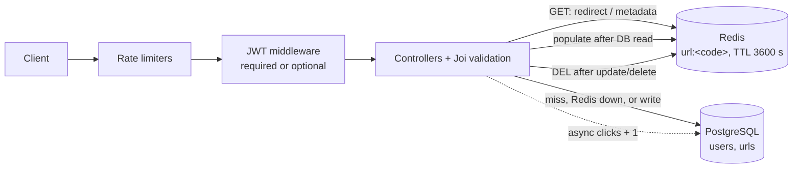

# 🔗 Shrinkr

**A URL-shortener REST API with JWT auth, owner-scoped link management, link expiry, and a Redis cache-aside layer in front of PostgreSQL — with a React dashboard on top.**


**🌐 Live demo (Render):** [Front end](https://shrinkr-urlshortner.onrender.com/login) · [API health check](https://shrinkr-zlrw.onrender.com/health)
<sub>Free-tier hosting: the first request after idle time can take a few seconds while the service wakes up.</sub>

---

## ⚡ At a glance

| | |
|---|---|
| **98.84% fewer URL-lookup queries** | Redis cache-aside cut PostgreSQL lookups from 10,000 to 116 across 10,000 synthetic redirects ([benchmark](#-performance-benchmark)) |
| **34 / 34 integration tests passing** | Run against real PostgreSQL and Redis — no mocks for the data stores |
| **Cache is never a dependency** | If Redis is down, slow (250 ms timeout) or returns garbage, PostgreSQL answers instead |
| **9 REST endpoints** | Auth, owner-scoped CRUD, metadata, and `302` redirects, all validated with Joi |

## 📌 Overview

Shrinkr turns long URLs into short codes and redirects visitors to the original address. Anyone can create a
link; registered users can list, update, and delete their own links from a React dashboard. Redirects are the
hot path — read-heavy and highly repetitive — so they are served from Redis when possible and fall back to
PostgreSQL on a miss or when Redis is unavailable.

## ✨ Features

**Backend (`url-shortner/`)**
- **Shorten and redirect:** 6-character codes from `crypto.randomInt`, retried on a unique-constraint collision (up to 5 attempts). `GET /:shortCode` answers `302`.
- **Redis cache-aside:** `url:<code>` keys with a 3600 s TTL, invalidated on update/delete, with PostgreSQL fallback.
- **JWT authentication:** email/password with bcrypt (cost 10) and HS256 tokens (default 7-day expiry).
- **Owner-scoped CRUD:** only the creator can update or delete a link — enforced in the controller *and* in the SQL `WHERE user_id = …`.
- **Configurable expiry:** `expiration_days` from 1 to 365 (default 30); expired links return `410 Gone`, including cached ones.
- **Joi validation:** on every write; only `http://` and `https://` targets are accepted.
- **Layered rate limiting:** global, `/urls`, link-creation, and auth limiters via `express-rate-limit`.
- **Public/private links** and **click counting** on every successful redirect.

**Front end (`shrinkr-ui/frontend/`)**
- React 19 + Vite + Tailwind dashboard: register/login, create, edit, and delete links.
- QR-code generation for any short link, and light/dark themes.

## 🧰 Tech stack

| Layer | Technology |
|---|---|
| Runtime / framework | Node.js, Express 5 |
| Database | PostgreSQL via `pg` (parameterised SQL, no ORM) |
| Cache | Redis via `redis` v5 |
| Auth / security | `jsonwebtoken`, `bcrypt`, `express-rate-limit`, `cors` |
| Validation | Joi 18 |
| Testing | Node's built-in `node:test` runner against real PostgreSQL and Redis |
| Front end | React 19, Vite, Tailwind CSS, React Router, Axios, `qrcode` |
| Local infra / benchmark | Docker Compose, custom load generator in `url-shortner/scripts/bench/` |
| Hosting | Render |

## 🏗️ Architecture



### Redirect flow (`GET /:shortCode`)

```text
Client ──► GET /:shortCode
             │
             ▼
     ┌────────────────┐
     │ Global limiter │──────────────► 429 Too Many Requests
     └───────┬────────┘
             ▼
     ┌────────────────┐   HIT
     │  Redis GET     │─────────┐
     │ (250 ms limit) │         │
     └───────┬────────┘         │
             │ MISS / Redis down│
             ▼                  │
     ┌────────────────┐         │
     │ PostgreSQL     │──► 404  │
     │ SELECT         │         │
     └───────┬────────┘         │
             ▼                  ▼
     ┌──────────────────────────────┐
     │ Expiry check ──► 410 Gone     │
     └───────┬──────────────────────┘
             ▼
   Best-effort Redis SET EX 3600 (on a miss)
   Async click UPDATE
             ▼
          302 Redirect
```

**Writes:** `POST /urls` inserts into PostgreSQL only (nothing is cached at creation). `PUT` and `DELETE` verify
ownership, write to PostgreSQL, then delete the cache key; the next read repopulates it.

## 📊 Performance benchmark

**Workload:** 10,000 redirects across 100 URLs with an 80/20 skew (20 hot URLs get 80% of traffic),
20 keep-alive connections, 3 rounds per mode, medians reported. PostgreSQL 16 and Redis 7 in Docker on a single laptop.

| Metric | Cache off | Cache on | Reduction |
|---|---:|---:|---:|
| URL-lookup queries | 10,000 | 116 | **98.84%** |
| Total database queries | 20,000 | 10,116 | **49.42%** |

Only cold lookups reach PostgreSQL, so read load scales with *unique links* rather than *total traffic*.
Total queries fall by less because every redirect still writes one click-count `UPDATE` — batching those
writes is the next optimisation (see [Roadmap](#-roadmap)).

This is a local mechanism check, not a production load test; latency varied too much between rounds to quote.
Full methodology, provenance, and raw results: [`docs/benchmark.md`](docs/benchmark.md),
[`docs/benchmark-results.audit-2026-10-09.json`](docs/benchmark-results.audit-2026-10-09.json).

Reproduce from `url-shortner/`:

```bash
npm run benchmark:seed && npm run benchmark -- --out results.json
```

## 🧠 Design decisions

- **Cache-aside, not write-through.** Links are written once and read many times, so caching on read keeps memory focused on links people actually visit.
- **Redis is an optimisation, not a dependency.** Every cache call has a 250 ms timeout and any failure is treated as a miss — losing Redis costs latency, never availability.
- **The cache stores rows, not permissions.** Privacy and expiry are re-checked on every request, so a cached private or expired link can't leak.
- **Invalidate on write.** `PUT`/`DELETE` delete the key after the database commit, so users are never redirected to an edited or deleted target beyond a narrow race window (documented below).

## 📡 API

Base URL (local): `http://localhost:3000`. Protected endpoints take `Authorization: Bearer <jwt>`.
"Optional" means a valid token attaches the user; no token continues as anonymous.

| Method | Endpoint | Description | Auth |
|---|---|---|---|
| `POST` | `/auth/register` | Create an account; returns a token | None |
| `POST` | `/auth/login` | Log in; returns a token | None |
| `GET` | `/auth/me` | Return the decoded token claims | Required |
| `POST` | `/urls` | Create a short URL | Optional (sets the owner) |
| `GET` | `/urls` | List the caller's URLs | Required |
| `GET` | `/urls/:shortCode` | Read link metadata (privacy-checked) | Optional |
| `PUT` | `/urls/:shortCode` | Update `original_url` and/or `is_public` | Required, owner only |
| `DELETE` | `/urls/:shortCode` | Delete a link | Required, owner only |
| `GET` | `/:shortCode` | `302` redirect to the original URL | None |

Health checks: `GET /health` and `GET /urls/health`. Errors are returned as `{ "error": "<message>" }`.

<details>
<summary><b>Request fields, examples, and status codes</b></summary>

| Endpoint | Body |
|---|---|
| `POST /auth/register`, `POST /auth/login` | `email` (valid email), `password` (min 8 characters) |
| `POST /urls` | `original_url` (required, `http`/`https`), `expiration_days` (1–365, default 30), `is_public` (default `false`) |
| `PUT /urls/:shortCode` | `original_url` and/or `is_public`; omitted fields keep their value |

```bash
# Register (login is the same call to /auth/login)
curl -X POST http://localhost:3000/auth/register \
  -H 'Content-Type: application/json' \
  -d '{"email":"you@example.com","password":"change-me-please"}'

export TOKEN='<token-from-response>'

# Create a short URL (omit the header for an anonymous link)
curl -X POST http://localhost:3000/urls \
  -H 'Content-Type: application/json' -H "Authorization: Bearer $TOKEN" \
  -d '{"original_url":"https://example.com/some/long/path","expiration_days":7,"is_public":true}'

# Follow a redirect
curl -i http://localhost:3000/<shortCode>
```

| Code | When |
|---|---|
| `201` | URL or account created |
| `400` | Validation failure or malformed JSON |
| `401` | Missing, invalid, or expired token; wrong credentials |
| `403` | Not the owner, or private link read by a non-owner |
| `404` | Unknown short code or route |
| `409` | Email already registered |
| `410` | Link expired |
| `413` | Request body too large |
| `429` | Rate limit exceeded |
| `500` | Internal error |

</details>

## 🚀 Local setup

**Prerequisites:** Node.js 21+ and Docker with Compose (or your own PostgreSQL and Redis).

```bash
git clone https://github.com/ayesha2104/Shrinkr.git
cd Shrinkr/url-shortner
npm install
cp .env.example .env

# Disposable, loopback-only PostgreSQL (127.0.0.1:55433) and Redis (127.0.0.1:56379); creates the schema
docker compose -f docker-compose.bench.yml up -d
```

Point `.env` at those ports, using the database credentials from the `environment:` block of
`docker-compose.bench.yml`, and set `DB_SSL=false`. Then:

```bash
npm run dev     # API on http://localhost:3000
npm test        # 34 integration tests
```

Using your own PostgreSQL instead? Apply the migrations in order (both are safe to re-run):

```bash
psql "<connection-string>" -f src/migrations/000_create_urls.sql
psql "<connection-string>" -f src/migrations/001_add_users_and_auth.sql
```

**Front end:**

```bash
cd ../shrinkr-ui/frontend
npm install
cp .env.example .env   # set VITE_API_URL=http://localhost:3000
npm run dev
```

### Environment variables

| Variable | Required | Notes |
|---|---|---|
| `DB_HOST`, `DB_PORT`, `DB_USER`, `DB_PASSWORD`, `DB_NAME` | Yes | PostgreSQL connection |
| `DB_SSL` | No | TLS is on by default; set `false` for a local database |
| `REDIS_HOST`, `REDIS_PORT` | Yes | Redis connection |
| `REDIS_PASSWORD` | No | For managed or password-protected Redis |
| `JWT_SECRET` | Yes | The server refuses to start without it |
| `JWT_EXPIRY` | No | Default `7d` |
| `PORT` | No | Default `3000` |
| `REDIS_COMMAND_TIMEOUT_MS` | No | Default `250` |
| `REDIRECT_CACHE_ENABLED` | No | `false` bypasses Redis on redirects (benchmark only) |
| `ENABLE_DEBUG_METRICS`, `BENCHMARK_MODE` | No | Benchmark tooling; ignored when `NODE_ENV=production` |

## 🧪 Testing

`url-shortner/test/` holds **34 integration tests** (`api.test.js`: 31, `redirect-cache.test.js`: 3) that boot
the real Express app against real PostgreSQL and Redis. Coverage includes:

- Registration, login, and JWT rejection cases (missing, malformed, wrong secret, expired, `alg=none`, wrong algorithm)
- Ownership on update/delete, and public vs private metadata
- URL validation, expiry bounds, and short-code collision retry
- Redirects and click counting, including 20 concurrent redirects
- Rate limits and malformed JSON
- The cache: TTL, hit/miss, invalidation, privacy and expiry of cached rows, malformed cache entries, and Redis being unavailable

Last full run: **34 passed, 0 failed, 0 skipped** (PostgreSQL 16, Redis 7). The test tooling refuses non-loopback
database or Redis hosts, so it can never run against production.

## ⚖️ Trade-offs and what I'd change at scale

| Current design | Why it's fine today | At scale |
|---|---|---|
| In-memory, per-process rate limits | Single instance on Render | Move limits to Redis so they're shared across instances |
| No JWT revocation or refresh tokens | 7-day tokens, no sensitive data stored | Refresh-token rotation plus a Redis denylist for revoked tokens |
| Fire-and-forget click counter (one `UPDATE` per redirect) | Keeps redirects fast | Buffer clicks in Redis and flush in batches, which also removes the remaining per-redirect DB write |
| Cache-invalidation race: a read racing an update can re-cache the old row | Bounded by the 1-hour TTL | Versioned cache keys or compare-and-set on write |
| `GET /urls` is unpaginated | Users own a small number of links | Cursor-based pagination |
| `is_public` hides metadata, not redirects | Matches how short links are shared | Optional access-controlled redirects |
| CORS allows all origins | Auth uses bearer tokens, not cookies | Restrict to the front-end origin via an env var |
| Database TLS doesn't verify the server certificate | Traffic is still encrypted in transit | Pin the provider's CA certificate and set `rejectUnauthorized: true` |

## 🛣️ Roadmap

- [ ] Batched or queued click writes (removes the remaining per-redirect DB write)
- [ ] Redis-backed distributed rate limiting
- [ ] Pagination and filtering for `GET /urls`
- [ ] Versioned cache keys to close the invalidation race
- [ ] Richer analytics (per-click timestamps, referrers)
- [ ] CI pipeline running the integration suite on every push

## 📁 Repository structure

```text
.
├── docs/                       # benchmark methodology + raw JSON results
├── shrinkr-ui/frontend/        # React 19 + Vite + Tailwind dashboard
└── url-shortner/               # the API
    ├── index.js                # app wiring, error handlers, server start
    ├── docker-compose.bench.yml
    ├── src/
    │   ├── config/             # pg pool, Redis client
    │   ├── controllers/        # auth, urls
    │   ├── middlewares/        # JWT auth, rate limiters
    │   ├── routes/             # auth, urls, debug
    │   ├── migrations/         # SQL schema
    │   └── utils/              # cache helpers, short-code generator, query stats
    ├── scripts/bench/          # seed, load generator, local-only safety layer
    └── test/                   # integration tests
```

## 📄 License

The backend's `package.json` declares ISC; a `LICENSE` file has not been added yet. Issues and pull requests are
welcome — please run `npm test` against the local Compose services first.
